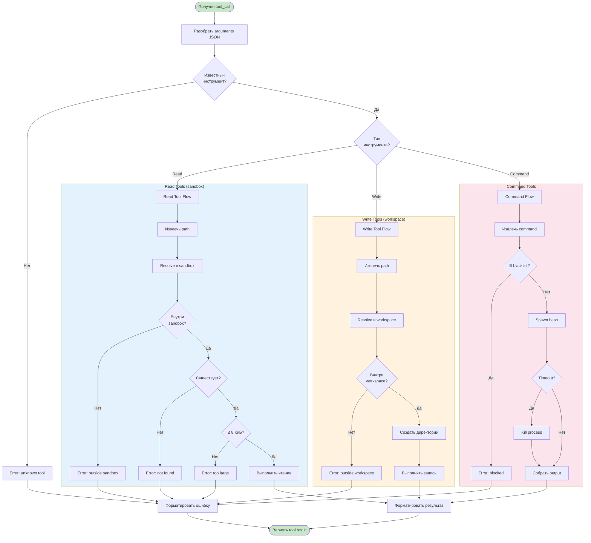
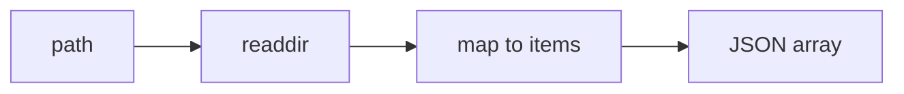
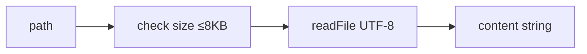
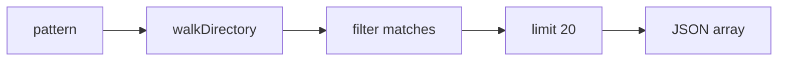
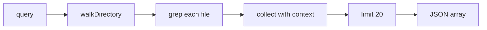
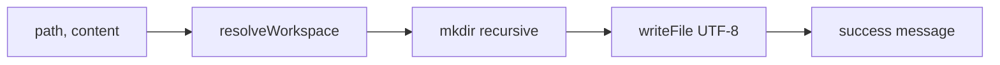
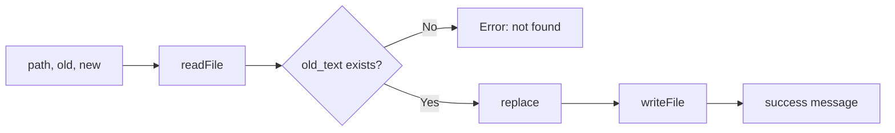
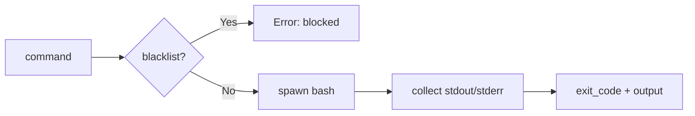

# Activity Diagram: Tool Execution

## Workflow выполнения инструмента

## Действия по инструментам

### Read Tools (sandbox)

#### list_directory

#### read_text

#### find_files

#### search_text

### Write Tools (workspace)

#### write_file

#### edit_file

#### run_command

## Validation Gates

| Gate | Check | Zone | Error |
|------|-------|------|-------|
| Tool name | `name in TOOLS` | all | unknown tool |
| Sandbox path | `realpath.startsWith(sandbox)` | sandbox | path outside sandbox |
| Workspace path | `normalized.startsWith(workspace)` | workspace | path outside workspace |
| File existence | `stat(path)` | read | not found |
| File size | `stat.size <= 8192` | read | file too large |
| Command safety | `!BLOCKED_COMMANDS.includes()` | command | blocked pattern |
| Command timeout | `< 10000ms` | command | killed |
| Output size | `stdout.length <= 4096` | command | truncated |
