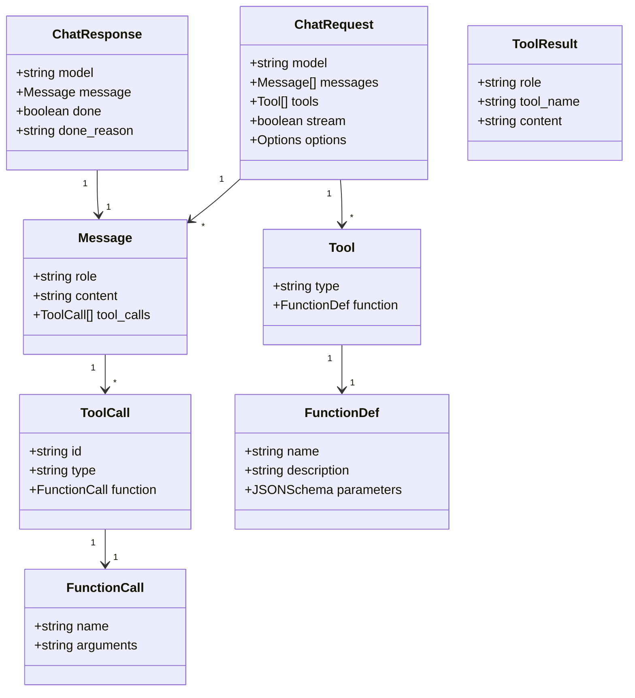
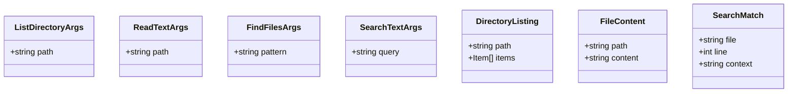
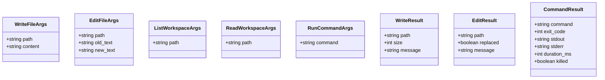
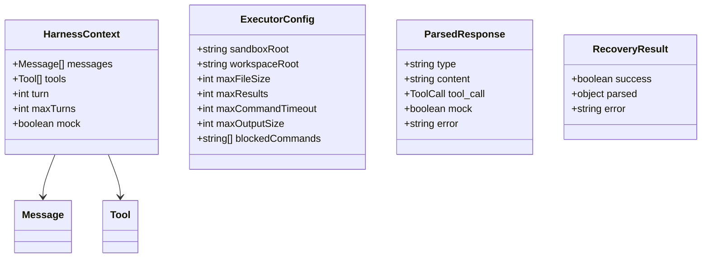

# Class Diagram: Data Structures

## Ollama API Structures



## Tool Definitions

### Read Tools (sandbox)


### Write Tools (workspace)


## Internal Structures



## Security Constants

```mermaid
classDiagram
    class SecurityLimits {
        +MAX_FILE_SIZE: 8192
        +MAX_SEARCH_RESULTS: 20
        +MAX_COMMAND_TIMEOUT: 10000
        +MAX_OUTPUT_SIZE: 4096
        +MAX_TURNS: 10
    }

    class BlockedCommands {
        +rm_rf_root: "rm -rf /"
        +rm_rf_home: "rm -rf ~"
        +sudo: "sudo"
        +su: "su "
        +chmod_777: "chmod 777"
        +mkfs: "mkfs"
        +dd: "dd if="
        +fork_bomb: ":(){"
        +dev_write: "> /dev/sd"
        +curl_pipe: "curl | sh"
        +wget_pipe: "wget | sh"
    }
```

## JSON Schema Examples

### Tool Definition
```json
{
  "type": "function",
  "function": {
    "name": "list_directory",
    "description": "List files in a directory",
    "parameters": {
      "type": "object",
      "properties": {
        "path": {
          "type": "string",
          "description": "Directory path"
        }
      },
      "required": ["path"]
    }
  }
}
```

### Tool Result
```json
{
  "role": "tool",
  "tool_name": "list_directory",
  "content": "{\"path\": \".\", \"items\": [\"file1.txt\", \"file2.txt\"]}"
}
```
