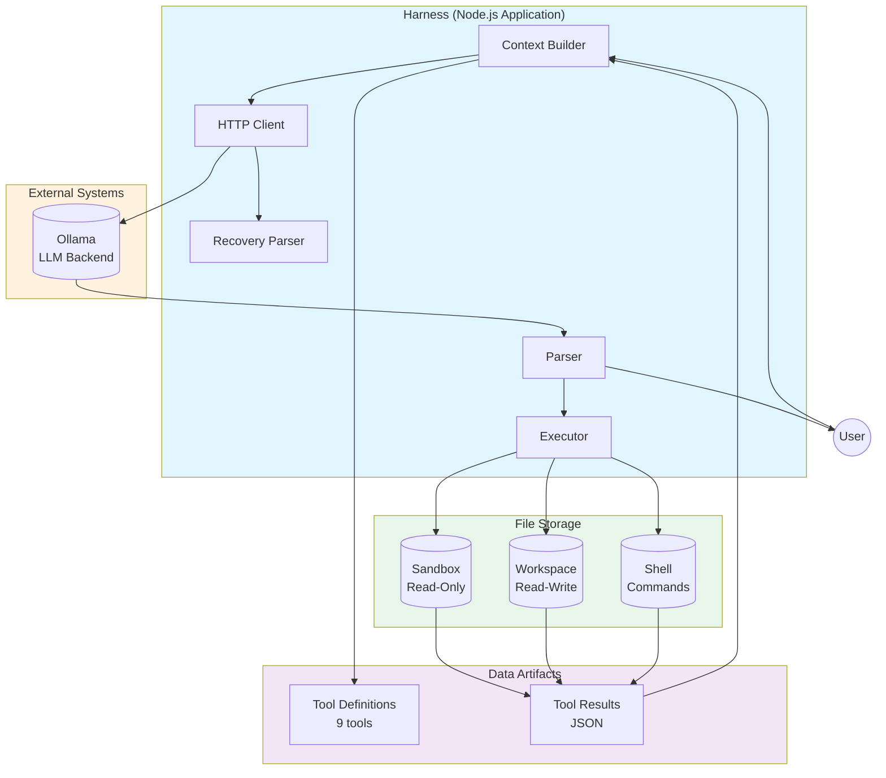
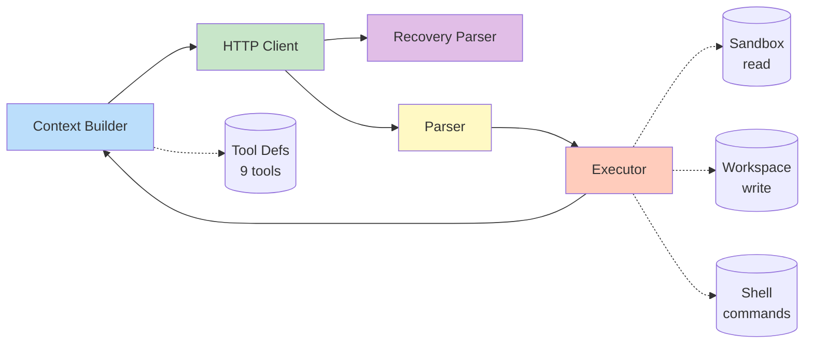
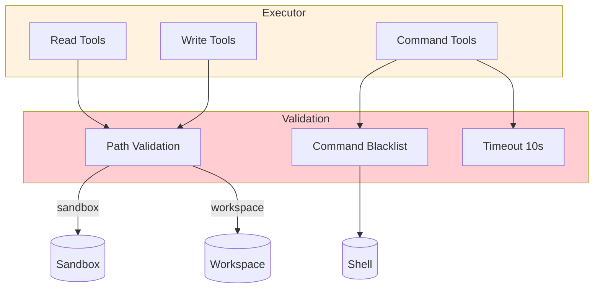

# Component Diagram: Harness

## C4 Level 3 — Components

## Компоненты

### Context Builder
- **Назначение**: Собирает контекст для запроса к модели
- **Входы**: User message, history, tool definitions (9 tools)
- **Выходы**: JSON request для Ollama API
- **Границы**: Не делает HTTP, не знает о модели, stateless
- **Реализация**: `lib/context.mjs`

### HTTP Client
- **Назначение**: Транспорт к Ollama API (mock или real)
- **Входы**: JSON request
- **Выходы**: JSON response, network errors
- **Границы**: Использует Recovery Parser для малых моделей
- **Реализация**: `lib/client.mjs`

### Recovery Parser
- **Назначение**: Восстанавливает malformed JSON от малых моделей
- **Входы**: Raw text response
- **Выходы**: Valid JSON или error
- **Границы**: Обрабатывает single quotes, trailing commas, missing braces
- **Реализация**: `lib/recovery.mjs`

### Parser
- **Назначение**: Разбирает ответ модели
- **Входы**: JSON response от Ollama
- **Выходы**: Text response или tool_calls
- **Границы**: Не выполняет tool calls, не валидирует аргументы
- **Реализация**: `lib/parser.mjs`

### Executor
- **Назначение**: Выполняет вызовы инструментов в двух зонах
- **Входы**: Tool call `{function: {name, arguments}}`
- **Выходы**: Tool result `{role: "tool", content: ...}`
- **Read tools**: sandbox (4 tools: list_directory, read_text, find_files, search_text)
- **Write tools**: workspace (5 tools: write_file, edit_file, list_workspace, read_workspace, run_command)
- **Границы**: Path traversal protection, command blacklist, timeouts
- **Реализация**: `lib/executor.mjs`

## Зависимости

## Security Model

