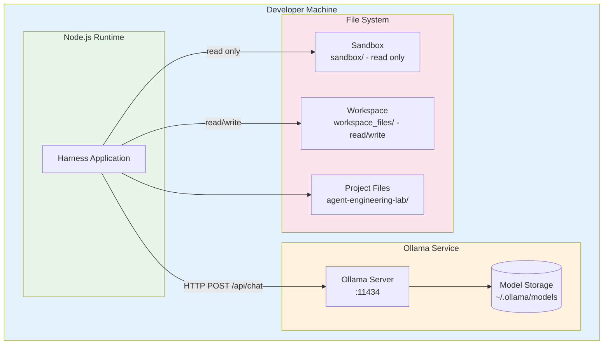
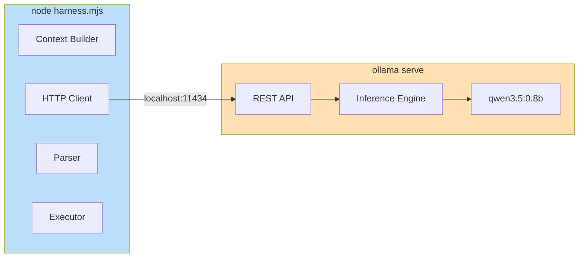
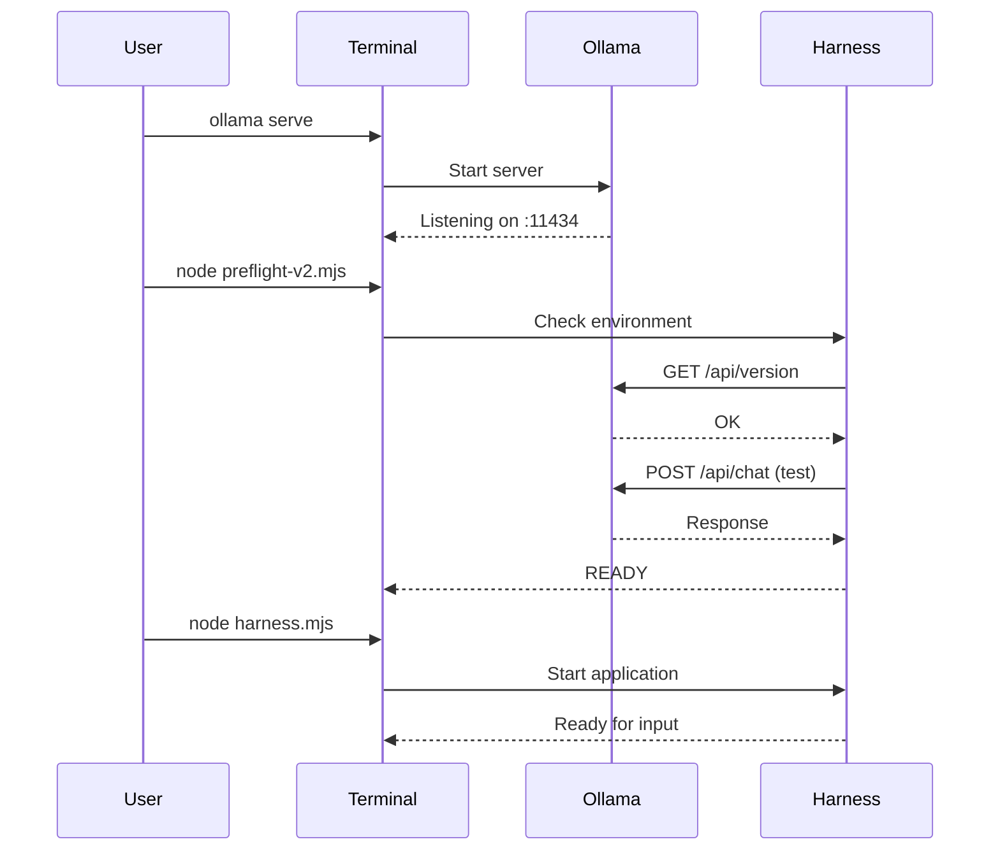
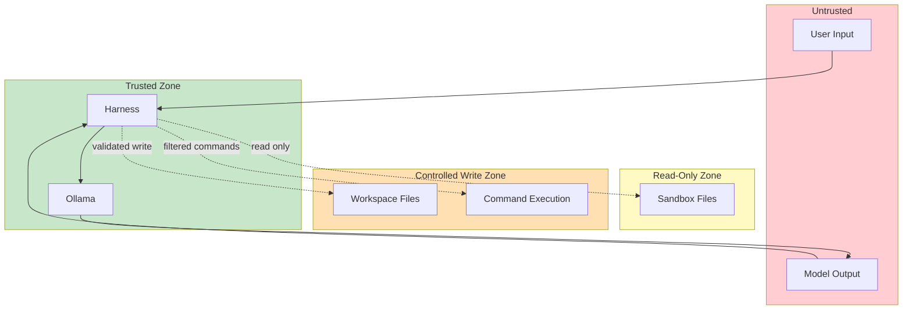

# Deployment Diagram: Local Development

## Infrastructure Overview



## Component Deployment



## Network Configuration

| Component | Host | Port | Protocol |
|-----------|------|------|----------|
| Harness | localhost | - | - |
| Ollama API | localhost | 11434 | HTTP |

## File System Layout

```
/home/user/
├── .ollama/
│   └── models/           # Ollama model storage
│       └── qwen3.5:0.8b/
│
└── tfw workshop/
    └── agent-engineering-lab/
        ├── harness.mjs           # CLI entry point
        ├── server.mjs            # Web server entry point
        ├── lib/
        │   ├── context.mjs       # Context Builder
        │   ├── client.mjs        # HTTP Client
        │   ├── parser.mjs        # Parser
        │   ├── executor.mjs      # Tool Executor
        │   ├── recovery.mjs      # JSON Recovery Parser
        │   └── events.mjs        # Event Logger
        ├── sandbox/              # Read-only file system
        │   ├── project-note.md
        │   ├── config.json
        │   └── notes/
        ├── workspace_files/      # Read/write area
        │   └── (model-created files)
        ├── web/                  # Web UI
        │   ├── index.html
        │   └── app.js
        └── docs/
            └── diagrams/
```

## Resource Requirements

| Resource | Minimum | Recommended |
|----------|---------|-------------|
| RAM | 4 GB | 8 GB |
| Disk (models) | 2 GB | 5 GB |
| CPU | 4 cores | 8 cores |
| Node.js | v24+ | v24+ |

## Startup Sequence



## Security Boundaries



- **User Input**: Валидируется перед отправкой
- **Model Output**: Не доверяем, парсим и валидируем
- **Sandbox**: Только чтение через Executor с проверками путей
- **Workspace**: Запись только в изолированную директорию
- **Commands**: Blacklist опасных команд (sudo, rm -rf /, etc.)
