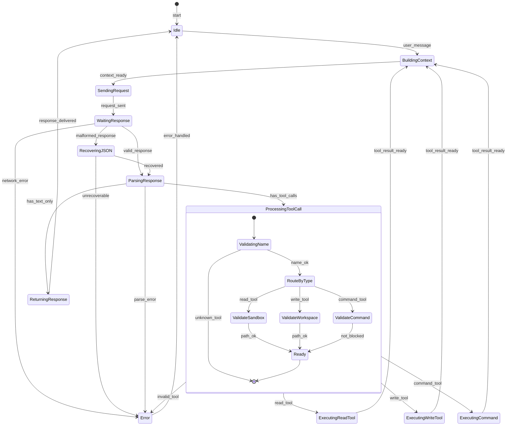
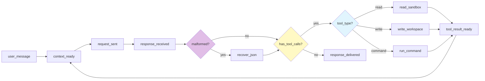

# State Diagram: Harness Loop

## Состояния обработки запроса

## Описание состояний

| Состояние | Описание | Следующие состояния |
|-----------|----------|---------------------|
| **Idle** | Ожидание запроса | BuildingContext |
| **BuildingContext** | Сборка messages, tools[9] | SendingRequest |
| **SendingRequest** | HTTP POST к Ollama | WaitingResponse |
| **WaitingResponse** | Ожидание ответа модели | RecoveringJSON, ParsingResponse, Error |
| **RecoveringJSON** | Восстановление malformed JSON | ParsingResponse, Error |
| **ParsingResponse** | Разбор JSON ответа | ProcessingToolCall, ReturningResponse, Error |
| **ProcessingToolCall** | Валидация и роутинг tool call | ExecutingReadTool, ExecutingWriteTool, ExecutingCommand, Error |
| **ExecutingReadTool** | Чтение из sandbox | BuildingContext (loop) |
| **ExecutingWriteTool** | Запись в workspace | BuildingContext (loop) |
| **ExecutingCommand** | Выполнение bash-команды | BuildingContext (loop) |
| **ReturningResponse** | Возврат ответа пользователю | Idle |
| **Error** | Обработка ошибки | Idle |

## Transitions

## Loop Invariants

1. **Max turns**: Цикл ограничен 10 итерациями (MAX_TURNS)
2. **State isolation**: Каждое состояние не хранит данные предыдущего
3. **Error as data**: Ошибки executor возвращаются модели, не прерывают цикл
4. **Tool isolation**: Read tools → sandbox, Write tools → workspace
5. **Command safety**: Blacklist + timeout + output limit
