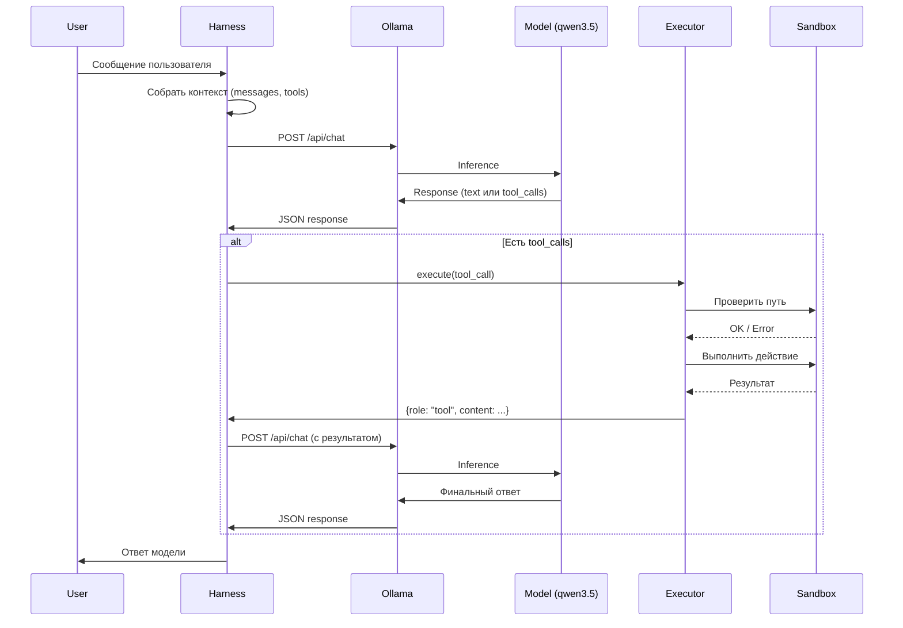

# Путь запроса

## Обзор

Запрос пользователя проходит через harness, модель, executor и возвращается ответом.

## Схема (Mermaid)



## Текстовое описание

### 1. Запрос пользователя → Harness

Harness принимает сообщение и формирует JSON-запрос:

```json
{
  "model": "qwen3.5:0.8b",
  "messages": [
    {"role": "user", "content": "Найди файл с заметками"}
  ],
  "tools": [...]
}
```

### 2. Harness → Ollama

HTTP POST на `http://localhost:11434/api/chat`

### 3. Ollama → Model

Ollama загружает модель и выполняет inference.

### 4. Model → Response

Два варианта:
- **Текстовый ответ**: модель отвечает напрямую
- **Tool call**: модель запрашивает выполнение инструмента

```json
{
  "message": {
    "role": "assistant",
    "tool_calls": [{
      "function": {
        "name": "list_directory",
        "arguments": "{\"path\": \".\"}"
      }
    }]
  }
}
```

### 5. Harness → Executor

Если есть `tool_calls`, harness передаёт вызов в executor.

### 6. Executor → Sandbox

Executor проверяет:
- Путь внутри sandbox (защита от path traversal)
- Размер файла (≤ 8 КиБ)
- Тип действия (только чтение)

### 7. Executor → Harness

Результат в формате Ollama:

```json
{
  "role": "tool",
  "tool_name": "list_directory",
  "content": "{\"path\": \".\", \"items\": [...]}"
}
```

### 8. Harness → Ollama (продолжение)

Harness добавляет результат в messages и отправляет повторный запрос.

### 9. Финальный ответ → User

Модель формирует ответ на основе результата инструмента.

## Границы ответственности

| Компонент | Отвечает за |
|-----------|-------------|
| Harness | Сборка контекста, HTTP, разбор JSON |
| Ollama | Управление моделями, inference |
| Model | Генерация текста, выбор инструментов |
| Executor | Выполнение инструментов, валидация |
| Sandbox | Изоляция файловой системы |

## Observability

Что должно быть видно в логах:
- Запрос пользователя
- Отправленный JSON (без secrets)
- Выбранный инструмент и аргументы
- Результат выполнения
- Финальный ответ
- Время каждого этапа
